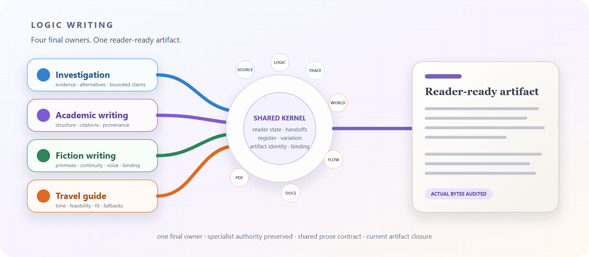
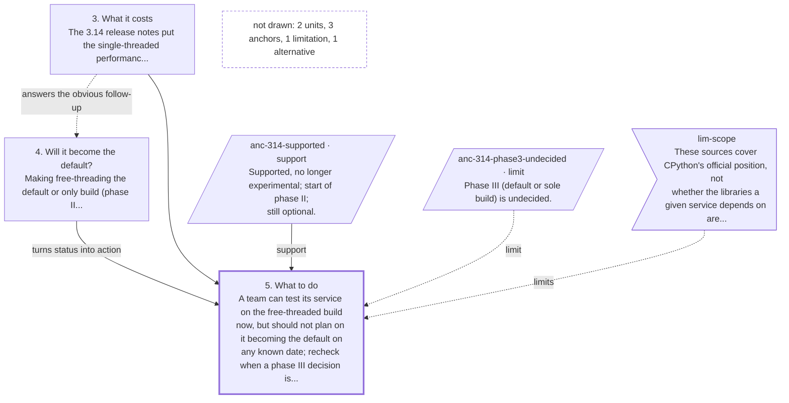
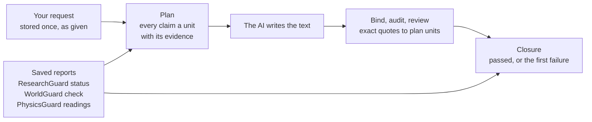

# Logic Writing

<p align="center">
  
  
  
  
</p>

<p align="center">
<!-- README HERO START -->
  
<!-- README HERO END -->
</p>

<p align="center"><strong>Your AI writes a long report, paper, story or guide whose claims slowly drift away from the evidence and from what you asked for. Logic Writing makes the whole plan visible before any prose, holds every planned claim to its evidence and to your request, and refuses to close a text whose claims, sources or reviews no longer match.</strong></p>

[中文说明](./README.zh-CN.md)

Logic Writing is an agent skill (Claude Code, Codex) made of Python scripts. It has one entry
and four routes, chosen by what you finally get: an **investigation** (a researched report or answer), an
**academic** piece, **fiction** or a story plan, a **travel guide**. The AI writes the text; the scripts check the plan
against the evidence, the text against the plan, and the review against the text, and decide whether the piece may be
called finished.

## 30 seconds: a claim with no evidence behind it

The repository ships a small investigation in `skills/logic-writing/assets/examples/investigation/`. The user asked:
*"Is free-threaded Python ready to be the default build? Tell me its official status as of Python 3.14 and whether we
should plan a migration now."* The research folder next to it says: officially supported in 3.14 but still optional,
the default switch undecided.

**Without Logic Writing**, the AI's conclusion gains one confident sentence that nothing in the research says:

> Teams should move production services to the free-threaded build this year.

**With Logic Writing**, every claim of the piece is first a unit of the plan, with the evidence it rests on. Here is the
AI's new unit. In a copy of the example (`cp -r skills/logic-writing/assets/examples/investigation ../ft-plan`) it goes
into `content_boundaries.content_units` of `../ft-plan/brief-request.json`, and its id into the `content_unit_ids` of the
planned unit `u-recommend`, the conclusion:

```json
{"content_unit_id": "cu-migrate", "safe_meaning": "Teams should move production services to the free-threaded build this year.",
 "required": true, "source": "ai", "evidence_anchor_ids": [], "alternative_ids": [], "limitation_ids": [], "model_row_ids": []}
```

The plan is checked before a word of the text is written:

```console
$ python skills/logic-writing/scripts/run_chain.py ../ft-plan --until brief
units: 5 (0 bound, 5 unbound: u-answer, u-history, u-cost, u-next, u-recommend); audit: not_run; review: not_run; closure: not_run; known-bad: not_run
added by the writer: cu-recommend: A team can test its service on the free-threaded build now, but should not plan on it becoming the default on any known date; recheck when a phase III decision is announced.
added by the writer: cu-migrate: Teams should move production services to the free-threaded build this year.
first failure: brief: content_unit_unsupported:cu-migrate (a required unit needs an evidence anchor that is not only counter, or an unsupported_reason)
```

The readback of the plan shows the same thing to a person: each `says:` line carries its own evidence, and the new one
has none.

```console
$ python skills/logic-writing/scripts/show_plan.py --input ../ft-plan/brief-request.json | sed -n '/^5\. /,$p'
5. What to do [UNBOUND]
   job: Decide
   reader: Has status, cost and outlook -> Has a plan and a recheck trigger
   says: A team can test its service on the free-threaded build now, but should not plan on it becoming the default on any known date; recheck when a phase III decision is announced. [anc-314-supported (support), anc-314-phase3-undecided (limit)]
   says: Teams should move production services to the free-threaded build this year. [no anchor]
   limit: These sources cover CPython's official position, not whether the libraries a given service depends on are ready.
```

The claim either gets evidence, or is dropped, or stays with a stated `unsupported_reason` that closure prints as a
residual risk for the reader. Before `v4.1.0` this plan was accepted, and with the sentence written into the text the
finished piece passed closure.

### When the evidence changes under the text

Continue with the `../ft-example` copy initialized in Quick start below. The research can change after the piece was
written: a source is corrected or another passage is quoted. Closure refuses an old saved report. In the diagnostic
below, `<ft-example>` abbreviates the absolute path of that copy:

```console
$ researchguard source add-anchor ../ft-example/research/source.yaml --source-id src-whatsnew-314 --anchor-id anc-314-heading --quote 'Free-threaded Python is officially supported' --locator 'Doc/whatsnew/3.14.rst, section heading' --output ../ft-example/research/source.yaml
{"ok": true, "output": "../ft-example/research/source.yaml"}
$ python skills/logic-writing/scripts/run_chain.py ../ft-example
units: 5 (0 bound, 5 unbound: u-answer, u-history, u-cost, u-next, u-recommend); audit: not_run; review: not_run; closure: not_run; known-bad: not_run
added by the writer: cu-recommend: A team can test its service on the free-threaded build now, but should not plan on it becoming the default on any known date; recheck when a phase III decision is announced.
first failure: brief: research_report_stale:source.yaml (saved report is from other inputs; run with --refresh-providers)
$ python skills/logic-writing/scripts/run_chain.py ../ft-example --refresh-providers
units: 5 (5 bound, 0 unbound); audit: passed (0 findings); review: passed; closure: not_run; known-bad: not_run
added by the writer: cu-recommend: A team can test its service on the free-threaded build now, but should not plan on it becoming the default on any known date; recheck when a phase III decision is announced.
first failure: closure: judgment_stale:reader_brief_fingerprint (the text, plan or evidence changed after the review was stamped; reread the text, then run python skills/logic-writing/scripts/run_chain.py <ft-example> --stamp-review)
$ python skills/logic-writing/scripts/run_chain.py ../ft-example --stamp-review
units: 5 (5 bound, 0 unbound); audit: passed (0 findings); review: passed; closure: not_run; known-bad: not_run
added by the writer: cu-recommend: A team can test its service on the free-threaded build now, but should not plan on it becoming the default on any known date; recheck when a phase III decision is announced.
stamped: closure-input.json judgment j-ft-1
$ python skills/logic-writing/scripts/run_chain.py ../ft-example
units: 5 (5 bound, 0 unbound); audit: passed (0 findings); review: passed; closure: passed (review stamped as a first review); known-bad: 0 uncaught
added by the writer: cu-recommend: A team can test its service on the free-threaded build now, but should not plan on it becoming the default on any known date; recheck when a phase III decision is announced.
```

The refresh asks ResearchGuard for a current report, then checks the existing text. The changed report makes the old
review stale. Here the added passage changes none of the existing judgments: check the affected text, plan or evidence,
update any affected review, then explicitly bind the completed review with `--stamp-review`. The default run passes. Refresh and default runs
never create or replace a review stamp.

### Discuss the argument with a picture

When you and the AI talk about how a piece argues, ask for the picture of its plan. `show_argument.py` draws it from
the folder's `reader-brief.json`, the plan the chain checked, not from the AI's memory of the outline: a solid arrow
means the later unit builds on the earlier one (`downstream_unit_ids`), a dotted arrow only that it comes next. What
the tool computes as a problem is red: a unit nothing later builds on, a conclusion no chain of links reaches, a live
alternative no unit answers, a researched claim with no supporting anchor or one that shares no word with one of
its anchors, and the audit and review findings. This comparison checks words: a claim with one shared word is not warned. With `--focus` it draws one unit with its neighbours and what the unit
rests on, and it lists what it left out. The owner asks: *"Why does it tell teams to test now but not to plan on a
default date?"*

```console
$ cp -r skills/logic-writing/assets/examples/investigation ../ft-argument
$ python skills/logic-writing/scripts/run_chain.py ../ft-argument
$ python skills/logic-writing/scripts/show_argument.py ../ft-argument --focus u-recommend
```

<!-- BEGIN COMPUTED PICTURE: show_argument.py ../ft-argument --focus u-recommend -->
**Argument of plan-ft-1 around u-recommend (5. What to do)**

Q: Should we plan for free-threaded Python now, and is it about to become the default?

units: 5 (5 bound, 0 unbound); audit: passed (0 findings); review: passed; closure: passed (review stamped as a first review); known-bad: 0 uncaught



Drawn: 6 boxes and 6 arrows (readable size 12 boxes, 20 arrows), computed from reader-brief.json.
Solid arrow: the later unit builds on the earlier one (downstream_unit_ids); dotted: it only comes next in reading order; the label is the later unit's relation_to_previous. Anchors point at the unit that cites them (dotted for limit or context, crossed for counter). Red: a problem below.

**Problems**

- none found

**Not drawn**

- units: u-answer (1. Short answer), u-history (2. From experimental to supported)
- anchors: anc-314-perf (u-cost), anc-313-experimental (u-history), anc-779-phase3-different (u-next)
- limitations: lim-perf (u-cost)
- alternatives: alt-default-soon (answered in u-next)
<!-- END COMPUTED PICTURE -->

Reply: *The recommendation builds on two steps: what free-threading costs (a 5-10% single-thread penalty a team must
measure) and whether it will become the default (phase III is undecided). Its own claim rests on two anchors: the
3.14 notes say the build is supported but still optional (support) and that phase III is undecided (limit). It also
carries one limitation: these sources say nothing about whether a service's libraries are ready. So "test now" comes
from the support status and "do not plan on a date" from the undecided default. The picture leaves out the opening and
history units, three anchors cited elsewhere, the cost unit's own limitation, and the "default soon" alternative,
which the outlook unit answers.*

Without `--focus` the tool draws every unit while that stays readable (12 boxes), the plan's top-level parts beyond
that, and otherwise lists the parts to draw one at a time. `--json` gives the same picture as data.

## Quick start

**1. Install the skill, from the release tag.**

The badge names v4.3.2. The clone command requires its published tag. An unpublished candidate can use the same
installer from its checkout; a successful installation byte check confirms that copy, not tag publication.

```bash
git clone --depth 1 --branch v4.3.2 https://github.com/liuyingxuvka/LogicWriting.git
cd LogicWriting
SKILLS_DIR=~/.claude/skills  # or ~/.codex/skills, or "$CODEX_HOME/skills"
python scripts/install_skill.py --target "$SKILLS_DIR"
python scripts/install_skill.py --target "$SKILLS_DIR" --check
```

The installer copies `skills/logic-writing/` to `<target>/logic-writing/`, replacing an older copy, without the
fixtures and regression runners that only this repository's tests use. `pip install` is not a way to install the
skill. The scripts need Python 3.10 or newer, and PyYAML when a piece uses a research folder or a world file.

**2. For research and story worlds, install the providers**, each from its own tag. Logic Writing reads their saved
reports; it needs the commands only to refresh them. ResearchGuard requires 0.8.0. WorldGuard 0.8.0 supplies tree
reports; the existing single-contract path still supports 0.7.23:

```bash
python -m pip install "git+https://github.com/liuyingxuvka/ResearchGuard.git@v0.8.1"
python -m pip install "git+https://github.com/liuyingxuvka/WorldGuard.git@v0.8.0"
```

For physical quantities, optionally install PhysicsGuard v0.18.1 from its repository. Its unit table is the only conversion owner; without it unit checks stay grey. A plain brief needs no PhysicsGuard. The minimum unit API remains 0.18.0; inlet-role binding uses `source_entity` only when a newer native report supplies it. Older scalar reports do not verify entity roles.

**3. The first commands**, in the cloned folder:

```bash
cp -r skills/logic-writing/assets/examples/investigation ../ft-example
python skills/logic-writing/scripts/show_plan.py --input ../ft-example/brief-request.json
python skills/logic-writing/scripts/run_chain.py ../ft-example
```

The shipped review is already completed and stamped. A stamp binds the text, the plan and the evidence, not the folder
they sit in, so the copy closes where it is. For your own work, check the affected text, plan or evidence,
update the necessary review, then explicitly stamp it when complete;
a complete repair review may be stamped while its closure remains `needs_repair`. Later default runs never re-stamp.

`show_plan.py` reads a plan back without writing anything: a summary line, then each planned unit with its job, what the
reader knows before and after, what it says and on which evidence. `run_chain.py` runs the checks on an existing text
(work on a copy: it writes its result files into the folder). Then ask your AI for the piece; the skill's description
makes it load Logic Writing for a finished report, paper, story or guide (in Codex you can also name it:
`$logic-writing`).

## How it works



- **The plan is the model of the piece.** One plan for the whole artifact: planned units (sections, scenes, days) with
  the job each does for the reader, and content units, the claims, each with its evidence anchors, alternatives and
  limits. Big units split into child units. Writing starts only from the plan.
- **The plan meets the evidence.** In an investigation or an academic piece, or whenever the plan names a research
  folder, a required unit needs a non-counter anchor or an explicit `unsupported_reason`, retained as residual risk.
  An anchor belongs to the saved research report or declares `outside_research` with a reason, also retained as risk.
  The bounded lexical check for unsupported alternatives permits a declared response; it is not a semantic proof.
- **The plan meets the request.** The user's request is stored once, as received. Every required unit says where it
  comes from: the request (with a verbatim quote of it), the research, or the AI; closure lists the units the writer
  added, so the user sees them.
- **The text meets the plan.** Exact quotes bind the text to the planned units; a deterministic audit checks the bound
  text; the route's review quotes the spans it judged. A review is stamped on the text it read, so an edit afterwards
  makes it stale, and closure says to reread and explicitly stamp again. The stamp keeps a sealed copy of the text it read; a
  new stamp on edited text is refused until the review quotes, for each change, the whole sentence that holds it,
  headings and the title included. Without that copy nothing can be compared: a review never stamped must be declared a
  first review (`--first-review`), and a review stamped before is never a first review; it is stamped again only on
  the text its stamp names. The closure line says which. Default runs never repair the stamp.
- **Known-bad copies.** `known_bad.py` makes small bad copies of the piece (a citation removed, a limit dropped, an
  unsupported alternative inserted, a unit's anchors stripped) and runs the checks on each; one that is not caught stays
  visible as a `toothless` risk.
- **Closure is computed.** It reads the saved results and reports, never re-runs a provider by itself, and turns nothing
  missing, stale or skipped into a pass. A self-review is labelled as such and cannot license a broad quality claim.

## How it works with the other Guard skills

Logic Writing reads the **saved** reports of ResearchGuard, WorldGuard and PhysicsGuard; it never calls them while it checks, and
`run_chain.py --refresh-providers` regenerates the reports when the inputs changed.

- **ResearchGuard → Logic Writing, per claim.** Save the research folder's status
  (`researchguard status ../ft-example/research --json --output ../ft-example/research-status.json`) and name `research_folder` and
  `research_status` in the brief. Each anchor the plan cites must be a row of that report (`anchor_not_in_research`,
  unless it declares `outside_research` with a reason, retained as risk). When the report withholds or qualifies the
  root claim, each required unit citing evidence supporting that claim must also carry a limit anchor or declared
  limitation (`wording_exceeds_license`). A report older
  than the folder is refused (`research_report_stale`).
- **WorldGuard → Logic Writing, by binding.** A fiction or travel plan names its world (`world_contract`) and the events
  each unit relies on (`world_refs`); closure accepts the text only with a WorldGuard report that belongs to the current
  world files. A whole tree of chapters binds the same way (`world_mesh`, by its `mesh_id` and `input_digests`); an old
  tree report without `mesh_id` is refused with the command that regenerates it. Actual report `scope_limits` remain
  visible as nonblocking risks; a provider PASS keeps those limits.

**PhysicsGuard → Logic Writing.** A brief's `provider_reports` names the saved JSON result; content-unit `model_row_ids` bind `pg:<row-id>`. The PG unit table converts quantities; changed request or source digests make saved rows stale, without rerunning the audit.

Native identity fields, when supplied, also bound what a green result can support:
source-backed inlet values retain their `source_entity` and `input_group`;
world-event quotations retain their named participant and literal time/date.
A compatible-unit matching number from another entity, year column or explicit assumption is
not an observed result for this claim. Ambiguous scope stays grey. These are
finite literal checks, not general natural-language understanding; conditional
models, caller-declared experiment observations and unverified world scopes
keep their stated uses and limits.
Property-dependent conversions between different dimensions remain unverified;
an entity-bound mass-flow row cannot borrow a requested volume-flow value.
Scalar entity rows also do not verify interval endpoints, unitless values or unread units.

Checking a claim, a source or a causal timeline on its own, without writing a finished piece, is ResearchGuard's job.

<!-- BEGIN GUARD FAMILY TABLE -->
## The Guard family

Five skills, one idea: each one makes the AI's answer meet a second record that the AI did not write in the same breath, and lets a tool, not the AI, do the step where the AI tends to slip. Each skill works on its own. LogicWriting reads saved ResearchGuard, WorldGuard and PhysicsGuard results. Physical unit conversion has one owner, PhysicsGuard's unit table.

| Skill | The AI weakness it makes up for | Use it when | Works with the others |
|---|---|---|---|
| [FlowGuard](https://github.com/liuyingxuvka/FlowGuard) | It changes one part of the software and does not see what that broke elsewhere; it rebuilds what already exists, or puts new code in the wrong place | you change, extend, refactor or audit software code, including the code of a simulation | Sends calculation results to PhysicsGuard, causal claims to ResearchGuard, story or plan consistency to WorldGuard, long texts to LogicWriting. The other four Guards are developed with FlowGuard |
| [PhysicsGuard](https://github.com/liuyingxuvka/PhysicsGuard) | It does physics in its head and is confidently wrong about units, signs and balances | a number comes from physics: a simulation result, test data, or a calculation the AI made itself | Sends the simulation's code to FlowGuard. LogicWriting reads its saved source-backed result rows; RG, WG and LW reuse its unit table |
| [ResearchGuard](https://github.com/liuyingxuvka/ResearchGuard) | It tells a confident causal story that its sources do not support | before a causal or evidential conclusion is stated: claims, sources, timelines, competing explanations | LogicWriting reads its saved status report. Sends the writing of the finished report to LogicWriting |
| [WorldGuard](https://github.com/liuyingxuvka/WorldGuard) | Across chapters, days or steps it forgets who holds what and who is where, and writes events that cannot happen | a story, trip, plan or process must stay consistent from step to step | LogicWriting reads its saved check report. Sends software code to FlowGuard |
| [LogicWriting](https://github.com/liuyingxuvka/LogicWriting) | In a long text it drifts away from its own plan and evidence | you need a finished piece for real readers: an investigation report, a paper, fiction or a story plan, a travel guide | Reads the saved reports of ResearchGuard, WorldGuard and PhysicsGuard. Sends the checking of claims on their own to ResearchGuard |
<!-- END GUARD FAMILY TABLE -->

## Honest limits

**What it does not do.**
- It does not write the text and does not judge whether it is true, beautiful, original or satisfying. Where the
  deterministic checks stop, a human or an independent reader has to judge, and closure says so.
- It does not cover casual copy, grammar-only edits, quick lookups, poetry as a general route, or short attraction
  lists.

**Where it can still miss.**
- Saved captures check explicit values and quoted words in linked source sections. Equal numbers do not prove
  semantic support: meanings outside explicit year columns, native inlet entities and assumption/measurement
  cues, as well as names outside quotes, can still escape.
- The test for a claim that restates an unsupported alternative compares content words. A paraphrase with different
  words passes it; the plan's prohibited overclaims and the review are the remaining defences.
- The route review and the reader judgment are written by an AI. A review by the same AI that wrote the piece is
  labelled self-review and never licenses a broad claim, but it is still the AI judging itself.

**What has been measured, and what has not.**
- Measured: one small trial during the design of this release, on the shipped investigation example, adding one plan
  unit or one sentence at a time (no long text was written). Caught: a research report older than the folder, and a
  claim placed as its own unplanned paragraph. Passed closure although wrong: a claim with no evidence, a claim that
  restated the unsupported alternative, an anchor that was not in the research folder, and an unqualified assertion of
  a root claim that ResearchGuard withheld. The four original finite controls are now refused; explicit reasons,
  declared responses and limitations retain their documented legal paths.
- Not measured: long pieces (by design, the trials never ask the skill to write one), and whether readers find the
  closed pieces better.

## Developing Logic Writing

```bash
python -m flowguard check --all
python scripts/check_public_docs.py
python scripts/run_fiction_regression.py --repository-root .
python scripts/run_travel_regression.py --repository-root .
```

CI runs all intent and native pytest tests, the fiction and travel regressions,
and the installed-skill byte check. The native contracts preserve the original
independent predicates and real script sequences. One intent rule guards the
exact-object fingerprint; shared Map queries guard error routes and default
reads. CI installs FlowGuard from the git tag pinned in its workflow, because
the PyPI package with that name is a different project. A second job checks the
minimum supported ResearchGuard. These checks cover scripts and contracts,
not the quality of a particular piece of writing. AI contributors start from
[`AGENTS.md`](./AGENTS.md); `CLAUDE.md` points to the same file.

## Links

- The skill: [`SKILL.md`](./skills/logic-writing/SKILL.md), [routing](./skills/logic-writing/references/router.md),
  [the reader chain](./skills/logic-writing/references/shared/reader-chain.md),
  [the brief](./skills/logic-writing/references/shared/reader-brief.md),
  [closure](./skills/logic-writing/references/shared/closure.md)
- The four routes: [investigation](./skills/logic-writing/references/routes/investigation.md),
  [academic writing](./skills/logic-writing/references/routes/academic-writing.md),
  [fiction](./skills/logic-writing/references/routes/fiction-writing.md),
  [travel guide](./skills/logic-writing/references/routes/travel-guide.md)
- The providers: [ResearchGuard](./skills/logic-writing/references/adapters/researchguard.md),
  [WorldGuard](./skills/logic-writing/references/adapters/worldguard.md)
- Worked examples: [`assets/examples/`](./skills/logic-writing/assets/examples/README.md)
- [Architecture](./docs/architecture.md), [responsibility map](./docs/responsibility-map.md),
  [migration guide](./MIGRATION.md), [contributing](./CONTRIBUTING.md), [changelog](./CHANGELOG.md)
- License: [MIT](./LICENSE)
