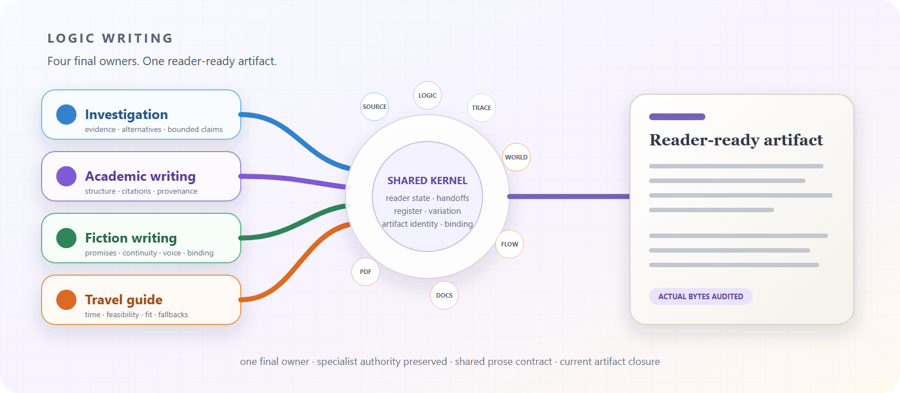
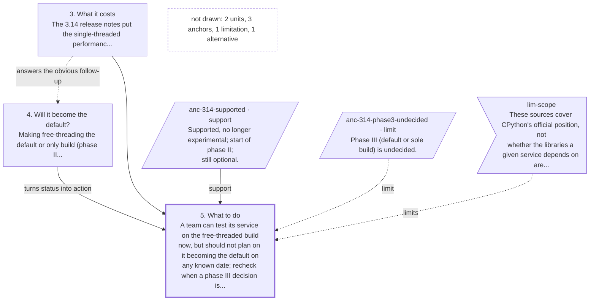
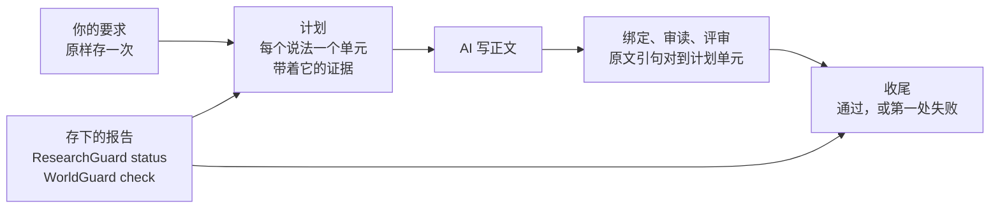

# Logic Writing

<p align="center">
  
  
  
  
</p>

<p align="center">
<!-- README HERO START -->
  
<!-- README HERO END -->
</p>

<p align="center"><strong>AI 写一篇长报告、论文、小说或攻略，写着写着，里面的说法就离证据、离你最初的要求越来越远。Logic Writing 在动笔之前先把整篇的计划摆出来，让计划里的每一个说法都对上它的证据和你的原话；说法、来源或评审对不上的文章，它不让收尾。</strong></p>

[English](./README.md)

Logic Writing 是一个 AI 技能（Claude Code、Codex 都能用），由一组 Python 脚本组成。它只有一个入口，按“最后交给你的是什么”
分四条路线：**调查**（有研究支撑的报告或回答）、**学术**写作、**小说**或故事计划、**旅行攻略**。正文由 AI 来写；脚本负责
拿计划去对证据、拿正文去对计划、拿评审去对正文，并决定这篇东西能不能算写完。

## 30 秒看懂：一句没有证据的话

仓库里自带一个小小的调查例子：`skills/logic-writing/assets/examples/investigation/`。用户问的是：*“free-threaded Python
可以当默认构建了吗？告诉我它在 Python 3.14 的正式状态，以及我们现在要不要规划迁移。”* 旁边的研究文件夹说的是：
3.14 正式支持，但仍是可选的；什么时候改成默认，还没有定。

**没有 Logic Writing**，AI 在结论里多写了一句很有把握的话，可研究里没有一处这样说：

> Teams should move production services to the free-threaded build this year.（各团队今年就应该把生产服务迁到 free-threaded 构建上。）

**用 Logic Writing**，文章里的每个说法先是计划里的一个单元，带着它所依靠的证据。下面是 AI 新加的那个单元。在例子的一份副本里
（`cp -r skills/logic-writing/assets/examples/investigation ../ft-plan`），把它加进 `../ft-plan/brief-request.json` 的
`content_boundaries.content_units`，再把它的 id 加进结论那一节（计划单元 `u-recommend`）的 `content_unit_ids`：

```json
{"content_unit_id": "cu-migrate", "safe_meaning": "Teams should move production services to the free-threaded build this year.",
 "required": true, "source": "ai", "evidence_anchor_ids": [], "alternative_ids": [], "limitation_ids": [], "model_row_ids": []}
```

正文一个字还没写，计划就先被检查：

```console
$ python skills/logic-writing/scripts/run_chain.py ../ft-plan --until brief
units: 5 (0 bound, 5 unbound: u-answer, u-history, u-cost, u-next, u-recommend); audit: not_run; review: not_run; closure: not_run; known-bad: not_run
added by the writer: cu-recommend: A team can test its service on the free-threaded build now, but should not plan on it becoming the default on any known date; recheck when a phase III decision is announced.
added by the writer: cu-migrate: Teams should move production services to the free-threaded build this year.
first failure: brief: content_unit_unsupported:cu-migrate (a required unit needs an evidence anchor that is not only counter, or an unsupported_reason)
```

计划的回读也把同一件事摆在人眼前：每一行 `says:` 后面跟着它自己的证据，新加的那一句什么都没有。

```console
$ python skills/logic-writing/scripts/show_plan.py --input ../ft-plan/brief-request.json | sed -n '/^5\. /,$p'
5. What to do [UNBOUND]
   job: Decide
   reader: Has status, cost and outlook -> Has a plan and a recheck trigger
   says: A team can test its service on the free-threaded build now, but should not plan on it becoming the default on any known date; recheck when a phase III decision is announced. [anc-314-supported (support), anc-314-phase3-undecided (limit)]
   says: Teams should move production services to the free-threaded build this year. [no anchor]
   limit: These sources cover CPython's official position, not whether the libraries a given service depends on are ready.
```

这个说法要么补上证据，要么删掉，要么留着但写明 `unsupported_reason`，收尾时作为剩余风险告诉读者。`v4.1.0` 之前，
这个计划会被接受；把这句话写进正文以后，成品照样能通过收尾。

### 正文写完以后，证据变了

接着使用下方“快速上手”里已初始化的 `../ft-example` 副本。正文写好以后研究还可能变：一个来源被更正了，或者又引了一段原文。
收尾会拒绝旧的研究报告。下面诊断里的 `<ft-example>` 代指这个副本的绝对路径：

```console
$ researchguard source add-anchor ../ft-example/research/source.yaml --source-id src-whatsnew-314 --anchor-id anc-314-heading --quote 'Free-threaded Python is officially supported' --locator 'Doc/whatsnew/3.14.rst, section heading' --output ../ft-example/research/source.yaml
{"ok": true, "output": "../ft-example/research/source.yaml"}
$ python skills/logic-writing/scripts/run_chain.py ../ft-example
units: 5 (0 bound, 5 unbound: u-answer, u-history, u-cost, u-next, u-recommend); audit: not_run; review: not_run; closure: not_run; known-bad: not_run
added by the writer: cu-recommend: A team can test its service on the free-threaded build now, but should not plan on it becoming the default on any known date; recheck when a phase III decision is announced.
first failure: brief: research_report_stale:source.yaml (saved report is from other inputs; run with --refresh-providers)
$ python skills/logic-writing/scripts/run_chain.py ../ft-example --refresh-providers
units: 5 (5 bound, 0 unbound); audit: passed (0 findings); review: passed; closure: not_run; known-bad: not_run
added by the writer: cu-recommend: A team can test its service on the free-threaded build now, but should not plan on it becoming the default on any known date; recheck when a phase III decision is announced.
first failure: closure: judgment_stale:reader_brief_fingerprint (the text, plan or evidence changed after the review was stamped; reread the text, then run python skills/logic-writing/scripts/run_chain.py <ft-example> --stamp-review)
$ python skills/logic-writing/scripts/run_chain.py ../ft-example --stamp-review
units: 5 (5 bound, 0 unbound); audit: passed (0 findings); review: passed; closure: not_run; known-bad: not_run
added by the writer: cu-recommend: A team can test its service on the free-threaded build now, but should not plan on it becoming the default on any known date; recheck when a phase III decision is announced.
stamped: closure-input.json judgment j-ft-1
$ python skills/logic-writing/scripts/run_chain.py ../ft-example
units: 5 (5 bound, 0 unbound); audit: passed (0 findings); review: passed; closure: passed (review stamped as a first review); known-bad: 0 uncaught
added by the writer: cu-recommend: A team can test its service on the free-threaded build now, but should not plan on it becoming the default on any known date; recheck when a phase III decision is announced.
```

刷新让 ResearchGuard 生成当前报告，再检查已有正文。报告变化会让旧评审章失效。这里新增摘录没有改变已有判断；检查变更涉及的
文本、计划或依据，更新必要评审，确认完成后显式 `--stamp-review` 绑定，再默认运行就能通过。刷新和默认运行都不会补盖或替换评审章。

### 讨论论证时用图

和 AI 讨论一篇文章怎么论证时，让它给出计划的图。`show_argument.py` 从文件夹里的 `reader-brief.json`（链条检查过的计划）
算出这张图，而不是凭 AI 对提纲的记忆：实线箭头表示后一个单元建立在前一个之上（`downstream_unit_ids`），虚线箭头只表示
它排在后面。工具算出的问题标成红色：后面没有单元用到的单元、没有一条链接能到达的结论、没有单元回应的现存替代说法、
没有支持锚点的研究性论断或与所引某个锚点没有一个共同词的论断，以及审读和复核的发现。加 `--focus` 时，它只画一个单元、它的
相邻单元和它所依据的内容，并列出省略了什么。主人问：*"为什么文章让团队现在就测试，却不要按某个日期计划默认版本？"*

```console
$ cp -r skills/logic-writing/assets/examples/investigation ../ft-argument
$ python skills/logic-writing/scripts/run_chain.py ../ft-argument
$ python skills/logic-writing/scripts/show_argument.py ../ft-argument --focus u-recommend
```

<!-- BEGIN COMPUTED PICTURE: show_argument.py ../ft-argument --focus u-recommend -->
**Argument of plan-ft-1 around u-recommend (5. What to do)**

Q: Should we plan for free-threaded Python now, and is it about to become the default?

units: 5 (5 bound, 0 unbound); audit: passed (0 findings); review: passed; closure: passed (review stamped as a first review); known-bad: 0 uncaught



Drawn: 6 boxes and 6 arrows (readable size 12 boxes, 20 arrows), computed from reader-brief.json.
Solid arrow: the later unit builds on the earlier one (downstream_unit_ids); dotted: it only comes next in reading order; the label is the later unit's relation_to_previous. Anchors point at the unit that cites them (dotted for limit or context, crossed for counter). Red: a problem below.

**Problems**

- none found

**Not drawn**

- units: u-answer (1. Short answer), u-history (2. From experimental to supported)
- anchors: anc-314-perf (u-cost), anc-313-experimental (u-history), anc-779-phase3-different (u-next)
- limitations: lim-perf (u-cost)
- alternatives: alt-default-soon (answered in u-next)
<!-- END COMPUTED PICTURE -->

回复：*建议这一步建立在两步之上：自由线程的代价（单线程慢 5-10%，需要团队自己测量），以及它会不会成为默认版本
（第三阶段尚未决定）。它自己的论断依据两个锚点：3.14 的说明写明这个版本受支持但仍是可选的（support），以及第三阶段
尚未决定（limit）。它还带着一条局限：这些来源没有说明某个服务依赖的库是否已经就绪。所以"现在测试"来自受支持的状态，
"不要按日期计划"来自尚未决定的默认版本。图里省略了开头和历史两个单元、在别处引用的三个锚点、代价单元自己的局限，
以及由前景单元回应的"很快成为默认"这一替代说法。*

不加 `--focus` 时，单元数在可读范围内（12 个框）就全部画出，超出时画计划的顶层部分，再超出就列出可以逐个画的部分。
`--json` 以数据形式给出同一张图。

## 快速上手

**1. 从发布的 tag 安装技能。**

徽章写的是 v4.2.0；下面的 clone 命令要求这个 tag 已正式发布。未发布的候选版本可以在其检出目录里用同一个安装器；
安装逐字节检查成功，只证明副本一致，不代表 tag 已发布。

```bash
git clone --depth 1 --branch v4.2.0 https://github.com/liuyingxuvka/LogicWriting.git
cd LogicWriting
SKILLS_DIR=~/.claude/skills  # or ~/.codex/skills, or "$CODEX_HOME/skills"
python scripts/install_skill.py --target "$SKILLS_DIR"
python scripts/install_skill.py --target "$SKILLS_DIR" --check
```

安装脚本把 `skills/logic-writing/` 复制到 `<目标>/logic-writing/`，替换旧的副本；只供本仓库测试用的夹具和回归脚本不会被带过去。
`pip install` 装不了这个技能。脚本需要 Python 3.10 或更新；文章用到研究文件夹或世界文件时，还需要 PyYAML。

**2. 涉及研究或故事世界时，装上两个提供方**，各自从自己的 tag 安装。Logic Writing 读的是它们存下的报告，只有刷新报告时才需要它们的命令。
ResearchGuard 最低为 0.6.0；WorldGuard 0.8.0 提供树报告，原有单 contract 路径仍支持 0.7.23：

```bash
python -m pip install "git+https://github.com/liuyingxuvka/ResearchGuard.git@v0.6.0"
python -m pip install "git+https://github.com/liuyingxuvka/WorldGuard.git@v0.8.0"
```

**3. 先跑这几条**，在克隆下来的目录里：

```bash
cp -r skills/logic-writing/assets/examples/investigation ../ft-example
python skills/logic-writing/scripts/show_plan.py --input ../ft-example/brief-request.json
python skills/logic-writing/scripts/run_chain.py ../ft-example
```

仓库例子的评审已经完成并盖过章。评审章绑定的是正文、计划和依据，不是它们所在的文件夹，所以复制出来的副本原地就能收尾。自己的文章应先
检查变更涉及的文本、计划或依据，更新必要评审，确认完成后再显式盖章。完整且发现缺陷的 repair 评审也可绑定，收尾仍为
`needs_repair`。以后的默认运行不会重盖。

`show_plan.py` 只读回计划、什么都不写：先是一行摘要，然后是每个计划单元——它为读者做什么、读者读前读后知道什么、它说了什么、
依靠哪些证据。`run_chain.py` 对已有的正文跑一遍检查（请在副本上跑，它会把结果文件写进目录）。然后就可以让你的 AI 写成品了：
要一篇报告、论文、小说或攻略时，技能的描述会让它加载 Logic Writing（在 Codex 里也可以直接点名：`$logic-writing`）。

## 它是怎么工作的



- **计划就是这篇东西的模型。** 整篇只有一个计划：计划单元（章节、场景、某一天）各自为读者做什么；内容单元就是说法，每个都带着
  证据锚点、其他可能的说法和限制。单元太大就拆成子单元。动笔只从计划出发。
- **计划要对上证据。** 在调查和学术写作里，或者计划指定了研究文件夹时，必需单元要有不只是反证的锚点，或显式 `unsupported_reason`
  并保留为风险。指定研究文件夹时，锚点属于存下的研究报告，或用 `outside_research` 说明报告外的原因并保留为风险。
  对不被支持的说法的有限词面检查允许已声明的回应，不是语义证明。
- **计划要对上你的要求。** 用户的原话原样存一次。每个必需单元都写明出处：来自要求（附一段一字不差的原话）、来自研究，还是 AI 自己加的；
  收尾时把作者自己加的单元列出来，让用户看得见。
- **正文要对上计划。** 原文引句把正文绑到计划单元上；确定性的审读检查绑好的正文；路线评审引用它评过的原文片段。评审盖章在它读过的正文上，
  之后再改正文，评审就过时了，收尾会提示检查受影响部分并显式重新盖章。盖章时会保存它读过的正文（带自身指纹）；正文改过之后再盖章，评审必须为每处改动重新引用改动所在的整句（标题和总标题也算），否则拒绝。没有这份副本就无从比较：从未盖过章的评审必须声明是第一次评审（`--first-review`）；盖过章的评审不算第一次评审，只能在它的章所指的那份正文上重新盖章。收尾那一行会写明是哪一种。默认运行不会修补评审章。
- **已知坏的副本。** `known_bad.py` 生成几份小小的坏副本（删一处引用、去掉一个限制、塞进一个不被支持的说法、拿掉一个单元的锚点），
  每份都跑一遍检查；没被抓住的那份不会消失，作为 `toothless` 风险留在收尾里。
- **收尾是算出来的。** 它只读存下的结果和报告，自己从不去调用提供方，也绝不把缺失、过时或没跑的检查算成通过。自我评审会标明是自我评审，
  不能拿来支撑“整体质量很好”这类大话。

## 和其他 Guard 技能怎么配合

Logic Writing 读的是 ResearchGuard 和 WorldGuard **存下的**报告；检查时从不调用它们。输入变了，`run_chain.py --refresh-providers`
会重新生成报告。

- **ResearchGuard → Logic Writing，逐个说法对。** 把研究文件夹的状态存下来（`researchguard status ../ft-example/research --json --output ../ft-example/research-status.json`），
  在简报里写上 `research_folder` 和 `research_status`。计划引用的每个锚点都必须是这份报告里的一行（`anchor_not_in_research`，除非这个锚点
  显式 `outside_research` 说明原因，并保留为风险）。报告对根结论暂不许可断言（withhold）或要求限定（qualify）时，引用了
  支持该根结论的证据的每个必需单元，都必须带限制锚点或已声明的 limitation（`wording_exceeds_license`）。比研究文件夹旧的报告会被拒绝（`research_report_stale`）。
- **WorldGuard → Logic Writing，靠绑定。** 小说或旅行的计划写明它的世界（`world_contract`）和每个单元依靠的事件（`world_refs`）；
  只有一份属于当前世界文件的 WorldGuard 报告存在，正文才能收尾。整棵章节树也能这样绑定（`world_mesh`，按 `mesh_id` 和 `input_digests`）；
  没有 `mesh_id` 的旧树报告会被拒绝，并给出重新生成它的命令。报告实际的 `scope_limits` 保留为不阻断的风险，provider PASS 不抹掉这些边界。

只检查一个说法、一个来源或一条因果时间线、不写成品，是 ResearchGuard 的事。

<!-- BEGIN GUARD FAMILY TABLE -->
## Guard 技能家族

五个技能，同一个思路：让 AI 的答案去对照一份不是它顺手写下的记录；AI 容易出错的那一步，交给工具来做，而不是让 AI 自己做。每个技能都可以单独用。技能之间唯一的数据交接，是 LogicWriting 读取 ResearchGuard 和 WorldGuard 存下的报告。

| 技能 | 它弥补 AI 的哪个弱点 | 什么时候用 | 和其他技能怎么配合 |
|---|---|---|---|
| [FlowGuard](https://github.com/liuyingxuvka/FlowGuard) | 改了软件的一处，看不到别处因此坏了；把已经有的东西再写一遍，或者把新代码放错地方 | 修改、扩展、重构或审查软件代码，包括仿真程序本身的代码 | 计算结果交给 PhysicsGuard，因果结论交给 ResearchGuard，故事或计划的前后一致交给 WorldGuard，长文交给 LogicWriting。另外四个 Guard 自己也是用 FlowGuard 开发的 |
| [PhysicsGuard](https://github.com/liuyingxuvka/PhysicsGuard) | 在脑子里算物理，单位、正负号、守恒算错了还说得很肯定 | 数字来自物理：仿真结果、试验数据，或者 AI 自己算的一道题 | 仿真程序的代码交给 FlowGuard。没有别的技能读它的报告 |
| [ResearchGuard](https://github.com/liuyingxuvka/ResearchGuard) | 讲出一个很有把握的因果故事，资料其实撑不住 | 说出一个因果或证据上的结论之前：论点、来源、时间线、几种互相竞争的解释 | LogicWriting 读取它存下的状态报告。把结论写成完整的报告，交给 LogicWriting |
| [WorldGuard](https://github.com/liuyingxuvka/WorldGuard) | 跨章节、跨天、跨步骤时，忘了谁手里有什么、谁在哪里，写出不可能发生的事 | 一个故事、行程、计划或流程，要每一步都前后一致 | LogicWriting 读取它存下的检查报告。软件代码交给 FlowGuard |
| [LogicWriting](https://github.com/liuyingxuvka/LogicWriting) | 长文写着写着，偏离了自己的提纲和证据 | 要一篇给真实读者看的成品：调查报告、论文、小说或故事提纲、旅行攻略 | 读取 ResearchGuard 和 WorldGuard 存下的报告。只检查论点、不写成文，交给 ResearchGuard |
<!-- END GUARD FAMILY TABLE -->

## 实话实说：它的局限

**它不做的事。**
- 它不替你写正文，也不判断文章是否真实、优美、有原创性、让人满意。确定性检查管不到的地方，要由人或独立的读者来判断，收尾会写明这一点。
- 它不管随手的文案、只改语法、快速查询、作为通用路线的诗歌，以及简短的景点清单。

**它仍可能漏掉的。**
- 检查把一个说法绑到一个锚点上，但不会去读原始资料，看这个锚点是否真的支持那句话。那是 ResearchGuard 的事，也只能做到它的记录那么好。
- 判断“换个说法重复不被支持的说法”，比较的是实词。换一套词的转述可以绕过它；剩下的防线是计划里写明的禁用说法和评审。
- 路线评审和读者判断是 AI 写的。由写文章的同一个 AI 做的评审会标成自我评审，绝不能支撑整体质量的结论，但它终究是 AI 在评价自己。

**测过什么，没测过什么。**
- 测过：本版本设计期间做过一次小试验，用的就是仓库自带的调查例子，每次只加一个计划单元或一句话（没有写任何长文）。抓住的：比研究文件夹旧的报告、
  作为单独一段、计划里没有的说法。错了却通过收尾的：没有证据的说法、换个说法重复了不被支持的说法、研究文件夹里没有的锚点、把 ResearchGuard
  要求暂不许可断言的根结论直接说成定论。原来的四个有限控制现已被拒绝；显式原因、已声明回应和限制仍保留各自合法路径。
- 没测过：长篇（按规矩，试验从不让这个技能写长文），以及读者是否觉得收尾后的成品更好。

## 开发 Logic Writing

```bash
python -m pytest -q
python scripts/check_public_docs.py
python scripts/run_fiction_regression.py --repository-root .
python scripts/run_travel_regression.py --repository-root .
```

CI 会跑全部测试、小说和旅行的回归、装好的技能逐字节检查，以及 FlowGuard 的地图检查和发布检查：Logic Writing 用 FlowGuard 维护自己。
工作流只从 git tag 安装 FlowGuard（`git+https://github.com/liuyingxuvka/FlowGuard.git@v0.72.0`），因为 PyPI 上同名的包是另一个项目。
另一个 CI 作业检查 Logic Writing 支持的 ResearchGuard 最低版本。这些检查覆盖的是脚本和它们的约定，不是某一篇文章的质量。
参与开发的 AI 从 [`AGENTS.md`](./AGENTS.md) 读起；`CLAUDE.md` 让 Claude Code 读同一个文件。

## 链接

- 技能：[`SKILL.md`](./skills/logic-writing/SKILL.md)、[路由](./skills/logic-writing/references/router.md)、
  [阅读链](./skills/logic-writing/references/shared/reader-chain.md)、
  [简报](./skills/logic-writing/references/shared/reader-brief.md)、
  [收尾](./skills/logic-writing/references/shared/closure.md)
- 四条路线：[调查](./skills/logic-writing/references/routes/investigation.md)、
  [学术写作](./skills/logic-writing/references/routes/academic-writing.md)、
  [小说](./skills/logic-writing/references/routes/fiction-writing.md)、
  [旅行攻略](./skills/logic-writing/references/routes/travel-guide.md)
- 提供方：[ResearchGuard](./skills/logic-writing/references/adapters/researchguard.md)、
  [WorldGuard](./skills/logic-writing/references/adapters/worldguard.md)
- 完整示例：[`assets/examples/`](./skills/logic-writing/assets/examples/README.md)
- [架构](./docs/architecture.md)、[职责划分](./docs/responsibility-map.md)、[迁移指南](./MIGRATION.md)、
  [参与贡献](./CONTRIBUTING.md)、[更新记录](./CHANGELOG.md)
- 许可证：[MIT](./LICENSE)
